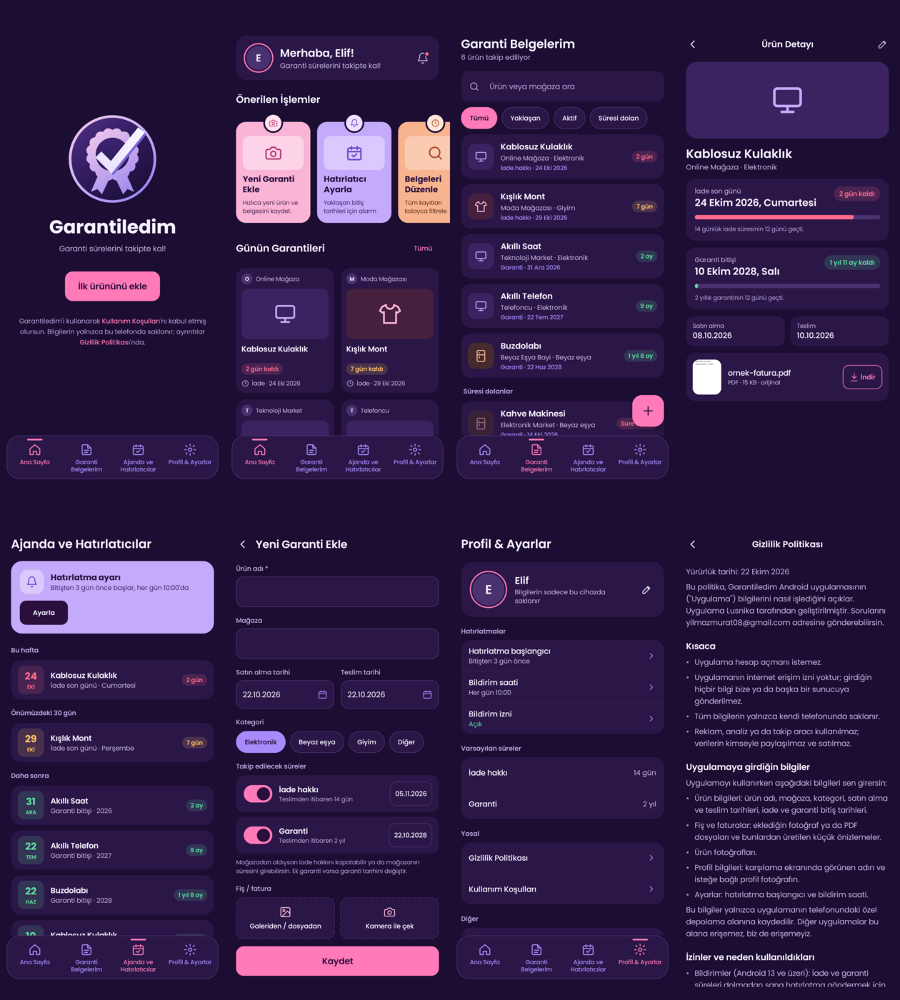

# Garantiledim

Satın alınan ürünlerin iade hakkı ve garanti sürelerini tek yerde takip eden Android uygulaması. Hesap ya da sunucu gerektirmez; tüm veriler cihazda tutulur. 3 ürüne kadar ücretsiz, Premium tek seferlik satın alma.

- Ürün gereksinimleri ve tasarım kuralları: [`SPEC.md`](SPEC.md)
- Tasarım referansları ve logo: [`design/`](design)

## Test APK'sı

Her push'ta GitHub Actions uygulamayı derler, birim testlerini çalıştırır, emülatörde tüm ekranları gezip görüntülerini alır ve imzalı APK'yı **test-latest** sürümüne koyar:

https://github.com/yilmazmurat08/garantiledim/releases/download/test-latest/garantiledim.apk

Telefona kurmak için bağlantıyı telefonda aç, indirilen dosyaya dokun; Android "bilinmeyen uygulamaları yükleme" izni isterse tarayıcıya bir kez izin ver. Yeni sürümler eskisinin üzerine kurulur, veriler korunur.



Bu APK test anahtarıyla (`app/signing/test.keystore`) imzalıdır ve yalnızca telefona doğrudan kurulum içindir. Play Store sürümü ayrı, gizli bir yükleme anahtarıyla imzalanacak; o anahtar bu depoya konmaz.

Ekran görüntüleri ve test çıktıları her derlemeden sonra `ci-screenshots` dalına yazılır.

Yerelde: `./gradlew testDebugUnitTest assembleRelease` (Android SDK gerekir). En düşük sürüm Android 8.0 (API 26).

## Play Store sürümü

Play Console'a yüklenen AAB, gizli **yükleme anahtarıyla** (`garantiledim-upload.jks`, alias `upload`) imzalanır. Anahtar ve şifresi bu depoda değildir; geliştiricide saklanır. Kaybolursa Play Console > Uygulama bütünlüğü bölümünden yükleme anahtarı sıfırlanabilir (uygulamanın asıl imza anahtarını Google tutar).

Yerelde imzalı AAB:

```
UPLOAD_KEYSTORE=/yol/garantiledim-upload.jks UPLOAD_STORE_PASSWORD=... BUILD_NUMBER=<sürüm kodu> ./gradlew bundleRelease
```

Play lisans anahtarı (`gradle.properties` > `garantiledim.playLicenseKey`) girilmeden AAB derlenmez; satın alma imzaları bu anahtarla doğrulanır (play/README.md). İlk kapalı test sürümü için `ALLOW_MISSING_PLAY_LICENSE_KEY=true` ile anahtarsız derlenebilir; bu sürümde Premium hiçbir şekilde açılmaz.

Çıktı: `app/build/outputs/bundle/release/app-release.aab`. R8 eşleme dosyası (`app/build/outputs/mapping/release/mapping.txt`) çökme raporlarını okunur kılmak için aynı sürüme Play Console'dan eklenir. Her yeni yüklemede `BUILD_NUMBER` (sürüm kodu) bir öncekinden büyük olmalıdır.

GitHub Actions'ın her derlemede imzalı AAB de üretmesi için depo ayarlarında (Settings > Secrets and variables > Actions) şu sırlar tanımlanır: `UPLOAD_KEYSTORE_BASE64` (`base64 -w0 garantiledim-upload.jks` çıktısı), `UPLOAD_STORE_PASSWORD`, `UPLOAD_KEY_ALIAS` (`upload`), `UPLOAD_KEY_PASSWORD`. Tanımlıysa AAB ve eşleme dosyası `garantiledim-play-<derleme no>` adlı çıktı olarak indirilebilir; herkese açık sürüme konmaz.

## Gizlilik politikası ve kullanım koşulları

Play Console'a verilecek herkese açık bağlantılar (uygulama içindeki metinlerle aynı dosyalar):

- Gizlilik politikası: https://github.com/yilmazmurat08/garantiledim/blob/main/app/src/main/assets/legal/gizlilik-politikasi.md
- Kullanım koşulları: https://github.com/yilmazmurat08/garantiledim/blob/main/app/src/main/assets/legal/kullanim-kosullari.md

## Yapı

```
app/src/main/java/com/garantiledim/app/
├── domain/   Süre hesaplama, sıralama, filtreler, Türkçe tarih biçimleri (Android'den bağımsız, testli)
├── data/     Room veritabanı, DataStore ayarları, fiş/fatura dosya işlemleri
├── notifications/  Günlük kontrol işi ve bildirimler
└── ui/       Compose ekranları, tema, ortak bileşenler, gezinme
```

## Durum

- [x] Tasarım sistemi, logo ve uygulama ikonu
- [x] Ana Sayfa, Garanti Belgelerim, Ürün ekle/düzenle, Ürün detayı, Ajanda, Profil & Ayarlar
- [x] Bir üründe iade ve garanti süresini birlikte takip etme
- [x] Fiş/fatura (fotoğraf veya PDF) ekleme, önizleme ve İndirilenler'e kaydetme
- [x] Bildirimler: bitişe 3 gün kala her gün, son gün ve süre dolunca (WorkManager)
- [x] Emülatörde otomatik testler: tüm ekranlar, fiş/fatura, indirme, bildirim
- [x] Gizlilik politikası ve kullanım koşulları (uygulamada Profil & Ayarlar > Yasal ve ilk açılış ekranı)
- [x] Play Store: yükleme anahtarı ve imzalı AAB
- [ ] Play Console: mağaza kaydı ve kapalı test
- [x] Türkçe ve İngilizce (Profil & Ayarlar > Dil)
- [x] Premium: tek seferlik satın alma (Google Play Faturalandırma), 3 ürün ücretsiz sınırı, yedekle / geri yükle
- [ ] Play Console: `garantiledim_premium` uygulama içi ürününü oluşturma (play/README.md)

Yazı tipi: Poppins, SIL Open Font License 1.1 ([`licenses/Poppins-OFL.txt`](licenses/Poppins-OFL.txt)).
